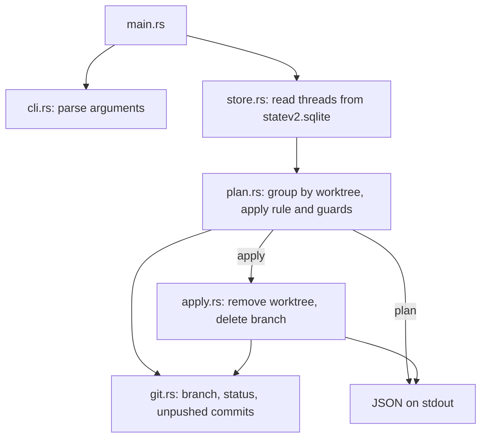
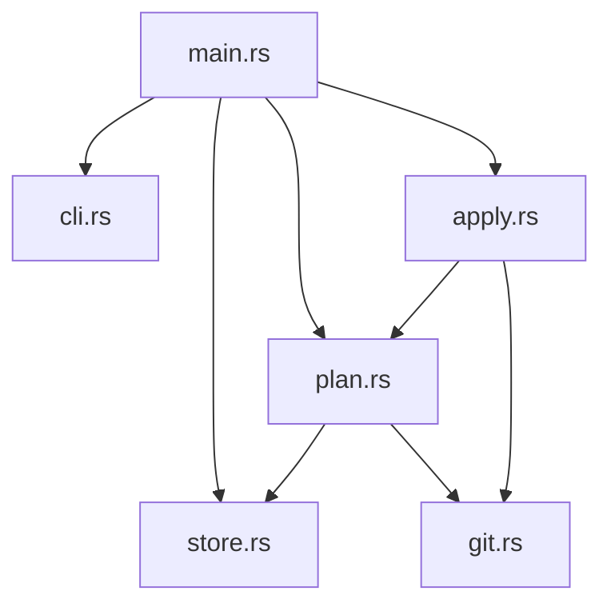

# Architecture

t3-worktree-cleanup is a small Rust CLI for developers' coding agents. It deletes
T3 Code worktrees whose threads have been inactive for longer than a limit. It
reads T3's state database read-only and runs git for every change, as recorded in
[ADR 0004](adr/0004-read-t3-state-locally.md). It applies its own rule instead of
T3's cleanup rules, as recorded in [ADR 0005](adr/0005-own-cleanup-rule.md).

## Runtime flow

Both commands build the same plan. `plan` prints it; `apply` deletes the requested
paths that still qualify in a freshly built plan. Nothing is stored between the
two commands, so the user confirms paths, not a saved plan.

1. `store` reads every thread with a `worktreePath`, including deleted and
   archived threads, with its project and last activity. Activity is the latest
   of thread creation, user message and run request, start and completion times.
2. `plan` groups threads by worktree path, keeps worktrees with at least one thread
   of the selected projects and drops paths that no longer exist. Threads of other
   projects in a kept worktree still count as activity. A worktree is `recent` if any thread was
   active after the cutoff. Otherwise it is a `candidate`, or `skipped` when it
   has uncommitted or untracked changes or commits no remote branch contains, or
   when these checks fail.
   The checked-out branch is marked for deletion unless it is `main`, `master` or
   the branch `origin/HEAD` points to.
3. `apply` finds each requested path in the plan. It skips recent worktrees, and
   skipped ones unless `--force` is set. `--force` never overrides a skip caused by
   failed checks. It runs `git worktree remove` from the
   project root, then `git branch -D`, and reports the branch's commit SHA.

## Modules and dependencies

- `src/main.rs`: wires the modules together, resolves the T3 home, prints JSON and
  selects the exit code.
- `src/cli.rs`: arguments, help and `--older-than` parsing.
- `src/store.rs`: the SQL query against T3's state database. It is the only module
  that knows T3's schema.
- `src/plan.rs`: grouping, the inactivity rule, the guards and the JSON plan.
- `src/apply.rs`: deletion and per-path results.
- `src/git.rs`: git commands. It knows nothing about T3.

Arrows show permitted dependencies.

`store` and `git` are leaves. Only `main` wires modules together.

## Output and exit codes

Results go to stdout as JSON. Errors that stop the tool go to stderr. `apply`
continues after a failed path and reports one result per path. Exit codes:

- `0`: success, including skipped paths.
- `1`: `apply` failed for at least one path.
- `2`: the tool could not run, for example because the database is missing or
  has an unexpected schema.

A branch that git refuses to delete, for example because another worktree has it
checked out, is reported in the result's `branch.note` and doesn't fail the path.

## Tests and quality gates

Unit tests sit next to the code. `tests/cli.rs` runs the binary against a
temporary T3 home with a minimal state database and real git repositories cloned
from a local bare origin. Tests never touch the real `~/.t3`.

`make check` runs rustfmt, Clippy with warnings as errors, tests, cargo-deny,
line coverage of at least 80 percent through cargo-llvm-cov and a CRAP limit of 12
per function through cargo-crap, which also reports duplicate functions.
`make mutants` runs cargo-mutants on code changed since `MUTATION_BASE`
(default `origin/main`) and fails on any surviving mutant.

GitHub Actions runs lint, tests, cargo-deny and coverage with CRAP on every pull
request and push to `main`. Pull requests also run the changed-code mutation
gate. A full mutation run is available through `workflow_dispatch`. See
[ADR 0003](adr/0003-quality-gates.md).

The [ADR index](adr/README.md) records the decisions behind these rules. Keep
changes proportionate to the tool's users and realistic failures, as described in
[ADR 0002](adr/0002-keep-the-tool-small.md).
