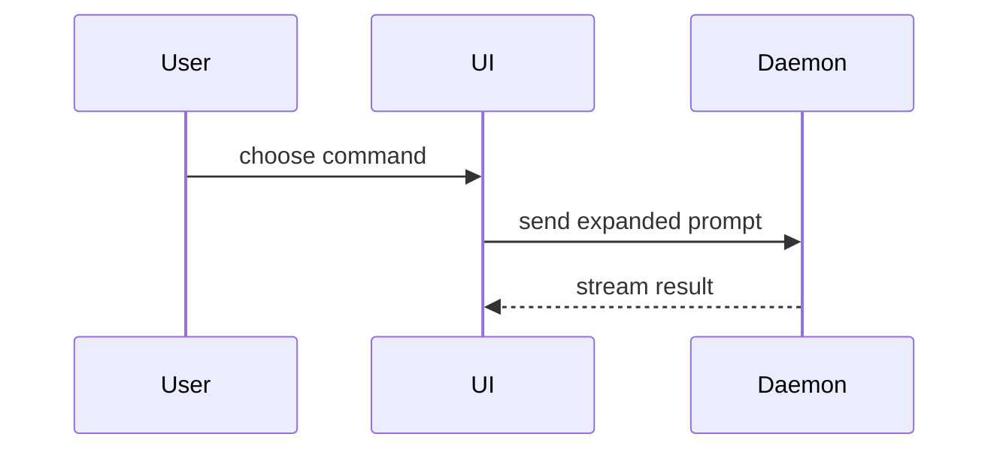

# Pull request visuals

Pick the smallest view that makes the key point clear. Most PRs need one visual, some need two, and none needs every type below. Keep only the calls, files, props, states, and boundaries the reviewer needs to follow the change, and place each visual next to the short text it supports.

The visual types and examples below are adapted from the `show-me` skill by [Dex Horthy](https://github.com/dexhorthy) ([HumanLayer](https://github.com/humanlayer/humanlayer)), via the `pr` skill in [mattpocock/skills](https://github.com/mattpocock/skills).

## Pseudocode

Use for logic or an algorithm.

```text
on(save)
  if content is unchanged
    return cached result
  write new content
  return fresh result
```

## Call tree

Use for runtime control flow.

```text
submitForm
  createSession
    persistPrompt
    launchAgent
  navigateToSession
```

## Component tree

Use for UI structure. Include the state and module boundaries that matter.

```text
<SessionPage> (apps/example/src/routes/session.tsx)
  useSessionEvents()
  <SessionToolbar>
    <RunSkillButton> (packages/ui)
```

## File tree

Use for file responsibilities or a broad refactor. Keep it shallow.

```text
src/
├── commands/       # parses user actions
├── sessions/       # owns session state
└── transport/      # sends API requests
```

## Mermaid diagram

Use for interaction between components, control flow, or data flow. GitHub renders `mermaid` code blocks as diagrams.



## Diff sketch

Use a `diff` block when the point is what changes and the surrounding shape already exists. Give the diff the shape of the topic: a component tree, a file tree, a call tree, or control flow.

A component change:

```diff
 <SessionPage>
   useSessionEvents()
   <SessionToolbar>
+    <RunSkillButton />
   <SessionTimeline>
+    <SkillResultCard />
```

A file layout change:

```diff
 src/
 ├── commands/
+│   └── show-me.ts       # expands the slash command
 ├── sessions/
-└── transport.ts
+└── transport/
+    ├── client.ts
+    └── stream.ts
```

A call tree change:

```diff
 submitForm
   createSession
     persistPrompt
+    expandSkillMention
     launchAgent
-  navigateToSession
+  navigateToSession
+    subscribeToEvents
```

A state or control flow change:

```diff
 on(save)
-  write content
+  if content is unchanged
+    return cached result
+  write new content
+  invalidate cache
```

## Whole code block

Show the whole block when most of it is new, when leaving out context would hide ownership or order, or when the reviewer needs the exact target shape.

```ts
function expandSkill(command: string): string {
  const skillName = command.slice(1);
  return `use the ${skillName} skill`;
}
```
